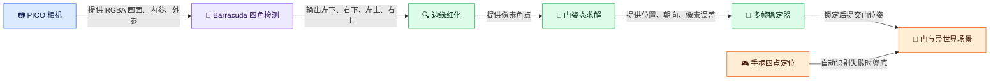
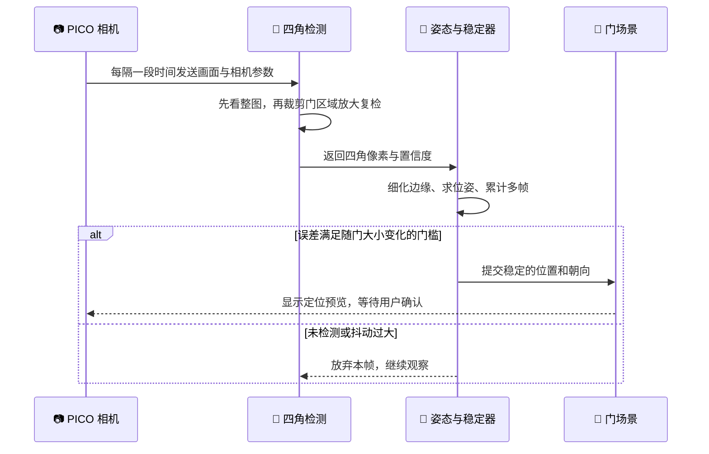

# PICO v1.12 门框视觉定位发布记录

版本：1.12（versionCode 13），包名：`com.suzume.portal`。
日期：2026-11-18，台北时间。

## 先说结论

这版已经完成训练、Unity 接入、编辑器对照检查和 APK 构建。门框定位改为“相机看见小门后自动找四角”，不要求在实体门上增加二维码、标记或其他配件；原来的手柄四点定位仍保留为兜底。

这版还不能写成“真机验收完成”。打包时 `adb devices` 为空，PICO 4 Ultra 没有接到电脑。相机能否取到正确方向的画面、相机外参与头显坐标是否一致、真机推理速度和最终贴合稳定性，都要接上头显后验证。

## 系统结构

坐标：**L2 / S3（模块级、看部件怎么连接）**。

坐标：**L2 / D3（模块级、看一帧到锁定的先后顺序）**。

## 这次入库的内容

| 部分 | 位置 | 作用 |
| --- | --- | --- |
| Unity 自动定位 | `suzume-scene-prep/picounity/Assets/Scripts/` | 取相机画面、检测四角、求门位姿并做多帧稳定 |
| Unity 对照检查 | `suzume-scene-prep/picounity/Assets/Editor/` | 用同一批图片核对 Unity 与 Python 的输出 |
| 最终 ONNX | `suzume-scene-prep/picounity/Assets/Resources/DoorNet/door_net.onnx` | APK 运行时使用的模型 |
| 模型工程 | `suzume-scene-prep/door-keypoint-model-20261118/` | 训练、评估、导出代码及 PyTorch/ONNX 权重 |
| Barracuda 3.0.2 | `suzume-scene-prep/picounity/Packages/com.unity.barracuda/` | Unity 内执行 ONNX；官方包下载失败后按原包内容本地嵌入，测试目录未带入 |
| 大型数据与 APK | GitHub Release | 避免把 100 MB 以上文件塞进普通 Git 历史 |

## 数据和模型结果

训练数据共有 3,600 张 960×720 渲染图，覆盖 50、60、70 mm 三档门尺寸，其中 430 张没有门，用于压低误检。模型输入为 1×288×384 灰度图，输出 72×96×12 的四角热图与偏移量，参数量约 109 万。

以下数字只代表渲染图，不代表实拍门：

| 测试集 | 有门图片 | 漏检 | 最差角点误差（中位 / 90%） | 单帧位姿误差中位数 |
| --- | ---: | ---: | ---: | ---: |
| 训练数据的验证部分 | 309 | 30 | 1.3 / 3.2 px | 1.1 mm / 1.0° |
| 独立渲染 500 张 | 480 | 42 | 0.9 / 2.4 px | 1.1 mm / 0.9° |

补充事实：独立集有 41 张无门图片，误检为 0；14 张有门图的误差超过 5 px；独立集漏检约 8.8%。这些失败样本没有被删掉或隐藏。

## Unity 检查结果

| 检查 | 结果 |
| --- | --- |
| Unity 与 Python 对照，360 张 | 有无门判断 358 张一致；角点差中位数 0.052 px，90% 为 0.175 px |
| 本机 GPU 单次推理 | 7.7 ms，设备为 RTX 4060 Laptop GPU |
| 本机 CPU 单次推理 | 78.6 ms |
| 门定位流程检查 | `PassthroughTrialCheck`、`ContinuousRayTrialCheck`、`StablePlacementTrialCheck`、`DoorVisionTrialCheck` 全部通过 |
| Android APK 构建 | Unity 2022.3.62f3 批处理构建成功 |

手动四点定位已放宽到几厘米的小门；自动识别失败时仍可继续完成体验。多帧锁定误差按门在画面中的高度变化：允许误差为门高的 2%，下限 1.5 px。

## 下载与校验

[APK](https://github.com/JavonLoong/suzume-visionpro/releases/download/pico-v1.12-door-vision-2026-11-18/SuzumePortal-PICO-v1.12.apk) · [训练数据](https://github.com/JavonLoong/suzume-visionpro/releases/download/pico-v1.12-door-vision-2026-11-18/door-keypoint-train-20261118.zip) · [独立评估数据](https://github.com/JavonLoong/suzume-visionpro/releases/download/pico-v1.12-door-vision-2026-11-18/door-keypoint-independent500-20261118.zip) · [Release](https://github.com/JavonLoong/suzume-visionpro/releases/tag/pico-v1.12-door-vision-2026-11-18)

| 文件 | SHA-256 |
| --- | --- |
| `SuzumePortal-PICO-v1.12.apk` | `5391ef63747cf31ab624e6453c650cbf7af63f46d3e2f9c074ab87d807fbc14f` |
| `door-keypoint-train-20261118.zip` | `247405ac5e51a76c629c18de9cd151aeae8b719d61a9d60810d4171740910dc3` |
| `door-keypoint-independent500-20261118.zip` | `e536442f2f2cd736ec6bc9a10d1b71d9876520af2e2316aec57f48ddfa2993f5` |

## 真机验证步骤

1. PICO 4 Ultra 系统升级到 5.15.0 或更高版本，并在头显里允许 USB 调试。
2. 电脑执行 `adb devices`，确认列表里出现设备且状态为 `device`。
3. 安装：`adb install -r SuzumePortal-PICO-v1.12.apk`。
4. 启动后检查相机画面方向、自动定位方向、门的大小与真实门是否贴合。
5. 应用会把前 30 帧诊断数据写到 `/sdcard/Android/data/com.suzume.portal/files/doorcam/`。执行 `adb pull /sdcard/Android/data/com.suzume.portal/files/doorcam/` 取回；每帧包含灰度图、相机内参、相机到世界的矩阵、角点与检测状态。
6. 记录真机推理耗时、掉帧、漏检和抖动，再决定是否需要用实拍图做第二轮训练。

PICO 相机图像接口的官方要求与用法见 [PICO Camera Image Data Management](https://developer.picoxr.com/document/unity/camera-image-data-management/)。
